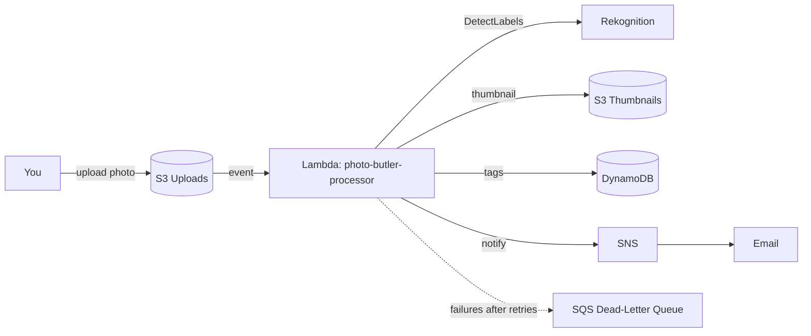

# 📸 Photo Butler: A Self-Organizing Photo Library on Serverless AWS

> Upload a photo. It tags itself, saves itself, and tells you about it, with **no servers running**.

Photo Butler is a hands-on serverless demo built for a live talk at **JKUAT**. It shows event-driven architecture on AWS using S3, Lambda, Rekognition, DynamoDB, and SNS, deployed with a single command using AWS SAM.

## What it does

1. You upload a `.jpg` or `.png` to an S3 bucket.
2. S3 triggers a Lambda function.
3. Lambda creates a 256px **thumbnail** and saves it to a second bucket.
4. **Amazon Rekognition** detects what's in the photo (Dog, Pizza, Beach...).
5. The tags are saved to **DynamoDB**.
6. **SNS** emails you: *"New photo added: Pizza, Food, Meal"*.
7. If processing fails, Lambda retries twice, then the event goes to an **SQS dead-letter queue** so nothing is silently lost.

> Nothing is running until a photo arrives. That is the serverless idea in one sentence.

## Architecture



| Service | Role |
|---|---|
| **S3 (uploads)** | Receives photos and fires the event |
| **Lambda** | Python 3.12 function that orchestrates everything |
| **Rekognition** | Detects labels in each image |
| **S3 (thumbnails)** | Stores resized copies (separate bucket to avoid trigger loops) |
| **DynamoDB** | Stores tags per photo (on-demand billing) |
| **SNS** | Sends the email notification |
| **SQS** | Dead-letter queue for failed photos |

## Prerequisites

- An AWS account and an IAM user with enough permissions to deploy (for a personal demo, `AdministratorAccess`)
- [AWS CLI](https://docs.aws.amazon.com/cli/latest/userguide/getting-started-install.html) configured with `aws configure`
- [AWS SAM CLI](https://docs.aws.amazon.com/serverless-application-model/latest/developerguide/install-sam-cli.html)
- [Docker](https://docs.docker.com/get-docker/) (used by `sam build --use-container` so Pillow is built for Lambda's Linux runtime)
- A region where Rekognition is available (default: `us-east-1`)

Check you're logged in as the right user:

```bash
aws sts get-caller-identity
```

## Deploy

```bash
git clone https://github.com/<your-username>/photo-butler.git
cd photo-butler

cp samconfig.toml.example samconfig.toml
# edit samconfig.toml and set your email in NotificationEmail

sam build
sam deploy
```

Or deploy interactively the first time:

```bash
sam build --use-container
sam deploy --guided --stack-name photo-butler
```

> ⚠️ **Confirm the SNS subscription.** AWS sends you a confirmation email. Click **Confirm subscription**, or no alerts will arrive. Check spam.

## Run the demo

Open two terminals in the project folder.

```bash
# Terminal 1: watch Lambda live
./scripts/demo.sh logs

# Terminal 2: upload a photo
./scripts/demo.sh upload pizza.jpg

# See the saved tags
./scripts/demo.sh show

# Optional: trigger a failure to show retries + dead-letter queue
./scripts/demo.sh fail
```

**What to expect (within a few seconds):**
- Lambda logs show the thumbnail and labels
- An email arrives with the tags
- The thumbnail appears in the thumbnails bucket
- DynamoDB has an item with every label and confidence score

### Suggested talk flow (20 minutes)

| Time | Segment |
|---|---|
| 0:00-2:00 | Hook: "Can you find that one photo in 10 seconds?" |
| 2:00-5:00 | Architecture walkthrough |
| 5:00-13:00 | Live demo (including the failure case) |
| 13:00-17:00 | Under the hood: the Lambda code and cost |
| 17:00-20:00 | Takeaways and Q&A |

## Project structure

```
photo-butler/
├── template.yaml            # SAM/CloudFormation infrastructure
├── samconfig.toml.example   # Deploy settings (copy to samconfig.toml)
├── src/
│   ├── app.py               # Lambda handler
│   └── requirements.txt     # Pillow
├── scripts/
│   └── demo.sh              # Demo helper (upload, fail, show, logs)
└── README.md
```

## How the Rekognition call works

```python
response = rekognition.detect_labels(
    Image={"S3Object": {"Bucket": bucket, "Name": key}},
    MaxLabels=8,
    MinConfidence=MIN_CONFIDENCE,
)
```

Rekognition reads the image straight from S3, so Lambda never sends image bytes. Labels below the confidence threshold (default 80%) are dropped.

## Why DynamoDB?

Rekognition returns tags but doesn't store them. DynamoDB gives a serverless, pay-per-request place to keep them, with instant lookup by photo ID and no schema to manage. It also means you pay nothing when no photos arrive.

## Security notes

- Both buckets block all public access.
- The Lambda role is least-privilege: read uploads, write thumbnails, write one table, publish to one topic, and `rekognition:DetectLabels` only.
- Never commit AWS access keys. `samconfig.toml` is git-ignored because it contains your email.

## Cost

Rekognition label detection is the main cost, roughly **$1 per 1,000 images**. Lambda, S3, DynamoDB (on-demand), and SNS are fractions of a cent at demo scale. Some of these services have free tiers. Prices change, so confirm with the [AWS Pricing Calculator](https://calculator.aws/).

## Clean up

Buckets must be empty before the stack can be deleted:

```bash
aws s3 rm s3://photo-butler-uploads-<ACCOUNT_ID>-<REGION> --recursive
aws s3 rm s3://photo-butler-thumbnails-<ACCOUNT_ID>-<REGION> --recursive
sam delete --stack-name photo-butler
```

## Troubleshooting

| Problem | Fix |
|---|---|
| `AccessDenied` on `CreateChangeSet` | The IAM user has no deploy permissions. Attach `AdministratorAccess` (demo only) and check for a permissions boundary. |
| `Uploaded file must be a non-empty zip` | `app.py` and `requirements.txt` must be inside `src/`. Rebuild with `rm -rf .aws-sam && sam build`. |
| Stack stuck in `ROLLBACK_COMPLETE` | Run `sam delete --stack-name photo-butler`, then deploy again. |
| No email arrives | Confirm the SNS subscription and check spam. |
| Nothing happens after upload | Only `.jpg` and `.png` trigger the function. Check the Lambda logs. |
| Docker errors during build | Start Docker, or try `sam build --use-container=false`. |

## Ideas to extend it

- Swap Rekognition for **Textract** to build a receipt scanner
- Add a **search API** (API Gateway + Lambda) to find photos by tag
- Add a DynamoDB **index on `topLabel`** to browse by category
- Add moderation using Rekognition's `DetectModerationLabels`

## Author

**Your Name** · [LinkedIn](https://linkedin.com/in/your-profile) · [GitHub](https://github.com/your-username)

Built for a live demo at JKUAT.

## License

MIT. See `LICENSE`.
